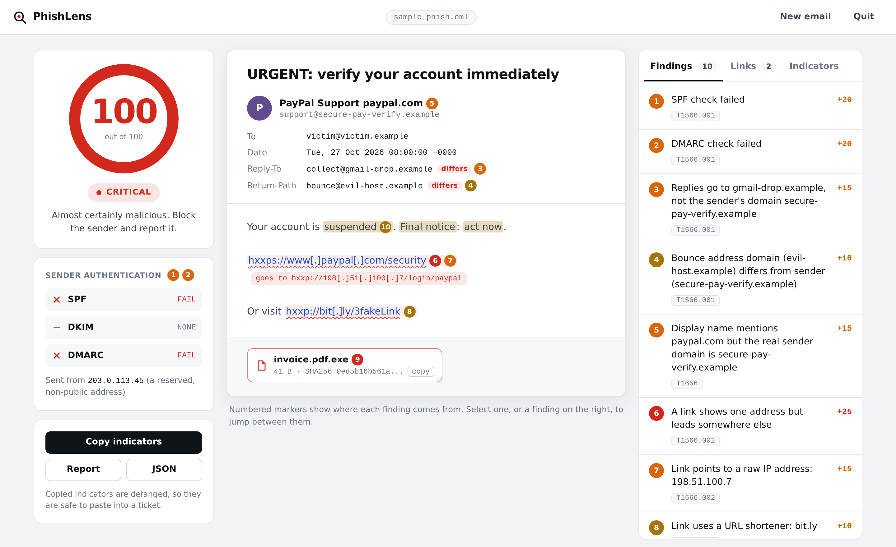
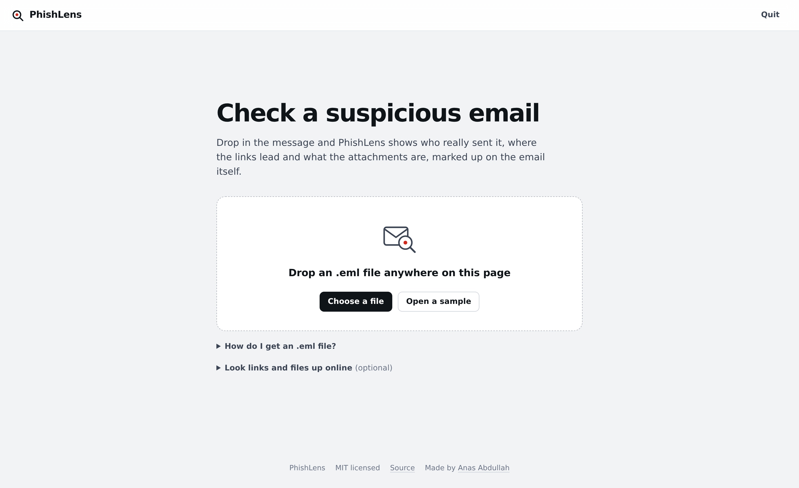
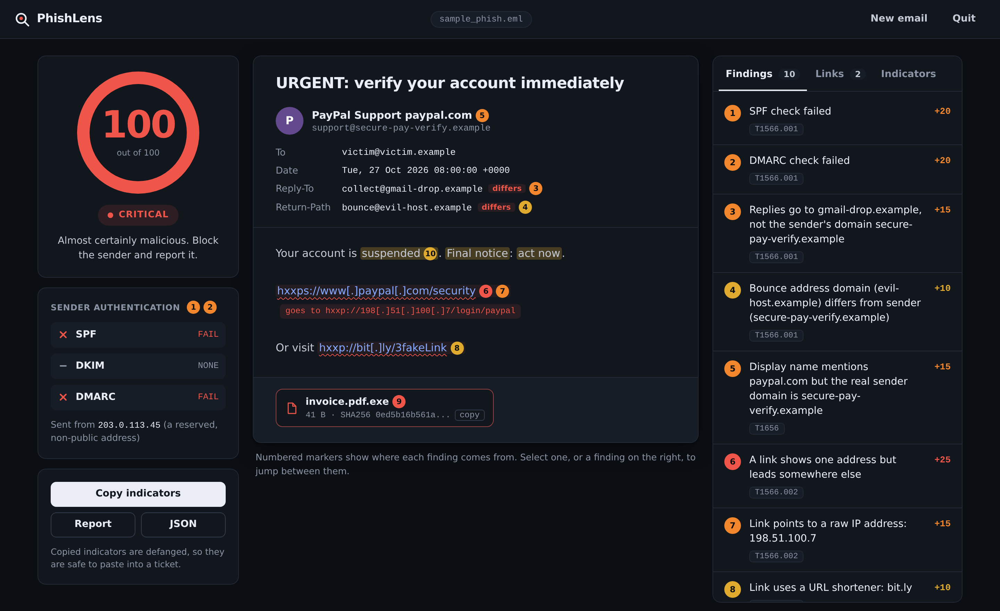
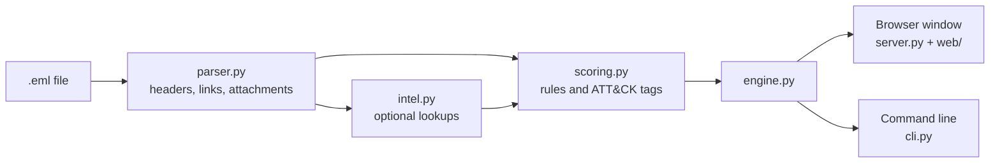

<div align="center">


# PhishLens

**Drop in a suspicious email. See exactly what's wrong with it.**

[](https://github.com/Anas-Abdullah-Sec/phishlens/actions/workflows/tests.yml)


<br>



</div>

<br>

PhishLens opens a phishing email the way an analyst would, then marks the evidence **on the email itself**. Numbered pins sit on the spoofed sender, the link that says one thing and goes somewhere else, the pressure words and the disguised attachment. Click a pin to see why it counts, or click a finding to jump to it.

Everything runs on your own computer. No account, no upload, no dependencies.

## Get it

### Windows, no Python needed

1. Download **`PhishLens.exe`** from the [latest release](https://github.com/Anas-Abdullah-Sec/phishlens/releases/latest).
2. Double-click it. A small console window opens (leave it open) and PhishLens appears in your browser.

Windows may say it "protected your PC" because the file is not code-signed. Choose **More info**, then **Run anyway**. The executable is built from this repository by GitHub Actions, and you can read the workflow in [`.github/workflows/release.yml`](.github/workflows/release.yml).

### Windows, if you already have Python

Press **Code, Download ZIP** on this page, extract it, and double-click **`Start-PhishLens.bat`**.

### Any system, with pip

You need Python 3.9 or newer ([python.org](https://www.python.org/downloads/)). Then:

```bash
python -m pip install https://github.com/Anas-Abdullah-Sec/phishlens/archive/refs/heads/main.zip
python -m phishlens gui
```

No Git required. If you prefer pipx: `pipx install git+https://github.com/Anas-Abdullah-Sec/phishlens.git`, then run `phishlens gui`.

## Using it

Drop an `.eml` file anywhere on the page, or press **Open a sample** to see a finished result straight away. When you are done, press **Quit** (or close the console window).

| Mail app | How to get the .eml |
|---|---|
| Gmail | Open the message, three dots, **Download message** |
| Outlook | Drag the message onto your desktop, or **File, Save As** |
| Apple Mail | **File, Save As**, format *Raw Message Source* |
| Thunderbird | Right-click the message, **Save As** |

<table>
<tr>
<td width="50%"></td>
<td width="50%"></td>
</tr>
</table>

The window follows your system's light or dark setting and works on a phone-sized screen too.

## What it checks

| Where | What PhishLens looks for |
|---|---|
| **Sender** | SPF, DKIM and DMARC results, replies or bounces going to another domain, display names that borrow a brand's domain |
| **Links** | Text that says one address while the link goes to another, raw IP addresses, URL shorteners, lookalike (punycode) domains |
| **Attachments** | SHA256 hashes and risky file types, including tricks like `invoice.pdf.exe`. Files are never opened |
| **Wording** | Pressure phrases such as "act now" and "account suspended" |

Every finding carries its [MITRE ATT&CK](https://attack.mitre.org/techniques/T1566/) technique. One click copies a defanged list of URLs, domains, IPs and hashes, ready for a ticket.

## The score

Each rule adds points, the total is capped at 100, and the report lists every rule that fired so the result can be explained.

| Signal | Points | ATT&CK |
|---|:-:|---|
| SPF failed or softfailed | +20 | T1566.001 |
| DMARC failed | +20 | T1566.001 |
| DKIM failed | +15 | T1566.001 |
| No authentication results at all | +5 | T1566 |
| Replies go to a different domain | +15 | T1566.001 |
| Bounce address is a different domain | +10 | T1566.001 |
| Display name borrows another domain | +15 | T1656 |
| Link text differs from its destination | +25 | T1566.002 |
| Link points to a raw IP address | +15 | T1566.002 |
| Lookalike (punycode) domain | +15 | T1566.002 |
| URL shortener | +10 | T1566.002 |
| Double-extension attachment | +30 | T1566.001 |
| Risky attachment type | +25 | T1566.001 |
| Pressure language | +10 | T1566 |
| Threat-intelligence hit | +30 | T1566 |

**0 to 24** low, **25 to 49** medium, **50 to 74** high, **75 to 100** critical. The rules live in [`phishlens/scoring.py`](phishlens/scoring.py) and are written to be read and tuned.

## Online lookups (optional)

PhishLens can check links, attachment hashes and the sender IP on VirusTotal and AbuseIPDB. Open **Look links and files up online** on the start screen and paste a free key from each. Only those indicators are sent, never the email. VirusTotal's free tier allows four requests a minute, so lookups are capped and paced, which is why this can take a while.

For the command line you can set the keys instead:

| Shell | Command |
|---|---|
| Windows CMD | `set VT_API_KEY=your_key` and `set ABUSEIPDB_API_KEY=your_key` |
| PowerShell | `$env:VT_API_KEY="your_key"` and `$env:ABUSEIPDB_API_KEY="your_key"` |
| Linux / macOS | `export VT_API_KEY=your_key` and `export ABUSEIPDB_API_KEY=your_key` |

## Command line

The same engine works without the window, which suits scripts and bulk work.

```bash
phishlens suspicious.eml                  # print a report
phishlens suspicious.eml -o report.md     # save it
phishlens suspicious.eml --format json    # machine-readable
phishlens suspicious.eml --no-intel       # skip online lookups
phishlens gui --port 9000 --no-browser    # run the window on another port
```

On Windows, if `phishlens` is not recognised, use `py -m phishlens` in its place.

## Built to be safe to run

Phishing emails are hostile input, so PhishLens is careful with them.

- **Nothing is executed.** Attachments are hashed, never opened.
- **Defanged output.** Links and link text appear as `hxxp://example[.]com`, and nothing in the window is clickable.
- **Local only.** The window's server listens on `127.0.0.1` and checks the `Host` and `Origin` headers plus a custom header on every request, so other websites cannot talk to it.
- **Hostile text stays text.** Anything taken from an email is shown as plain text, never as HTML, and a strict Content-Security-Policy backs that up. The tests feed it emails full of script tags to check.
- **No dependencies.** Standard library only, so there is nothing to go stale or be compromised.

## How it fits together



```text
phishlens/
├── parser.py     reads the email into evidence
├── scoring.py    turns evidence into a score, each finding pointing at its source
├── intel.py      VirusTotal and AbuseIPDB
├── report.py     Markdown, JSON and indicator lists
├── engine.py     one entry point for both interfaces
├── server.py     local web server
├── cli.py        command line
├── web/          the window (HTML, CSS, JavaScript)
└── samples/      two safe demo emails
tests/            unit and security tests
```

## Development

```bash
git clone https://github.com/Anas-Abdullah-Sec/phishlens.git
cd phishlens
python -m pip install -e .
python -m unittest discover -s tests -v
```

The tests cover the parser, the scoring rules, the reports and the server's security checks, and they run on Windows and Linux for every push.

**Publishing a new Windows build:** push a version tag and GitHub Actions builds `PhishLens.exe` and attaches it to a release.

```bash
git tag v1.0.0
git push origin v1.0.0
```

## Limitations

- A heuristic tool. A low score does not prove an email is safe, and a high score still deserves an analyst's eye.
- Domain comparison is simple (no public-suffix list), so unusual domains can occasionally be misjudged.
- SPF, DKIM and DMARC come from the `Authentication-Results` header your mail provider added. Forwarded or locally created messages may not have it.
- IPv4 only when reading the `Received` chain, and `.eml` only for now.

## Roadmap

- [ ] Outlook `.msg` support
- [ ] Scan a whole folder and export a summary CSV
- [ ] Publish to PyPI so `pip install phishlens` just works
- [ ] YARA and Sigma rule export from detected indicators

## Disclaimer

For education and defensive security. Only analyse emails you are authorised to examine. The bundled samples use reserved example domains and a harmless text file as the "attachment".

## Author

**Anas Abdullah**, Cybersecurity Analyst

[](https://github.com/Anas-Abdullah-Sec)
[](https://www.linkedin.com/in/anas2abdullah)

Released under the [MIT License](LICENSE).
