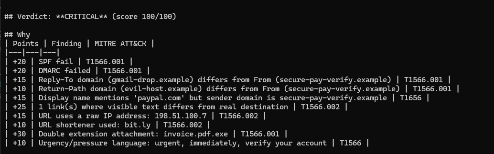
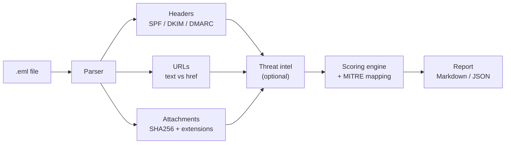

<div align="center">

# 🎣 Phishing Email Analyzer

**Triage suspicious emails like a SOC analyst, in one command.**

Header forensics · URL & attachment analysis · Threat-intel enrichment · Risk scoring · MITRE ATT&CK mapping

<br>


<br>

[Features](#-features) ·
[Quick Start](#-quick-start) ·
[Sample Output](#-sample-output) ·
[How It Works](#-how-it-works) ·
[Scoring](#-scoring-engine) ·
[Roadmap](#-roadmap)

</div>

---

## 🧭 Why this exists

Phishing is the most common way attackers get in, and reviewing suspicious emails is one of the most repetitive tasks in a SOC. This tool automates the first-pass triage: feed it a `.eml` file and get a clear verdict with the evidence behind it, in seconds.

> 🔒 **Safe by design.** Attachments are only hashed, never opened or executed. All URLs in reports are defanged (`hxxp://example[.]com`) so they are safe to share and paste into tickets.

## ✨ Features

| | Capability | Details |
|---|---|---|
| 📨 | **Header analysis** | SPF / DKIM / DMARC results, From vs Reply-To vs Return-Path mismatches, display-name spoofing, origin IP from the `Received` chain |
| 🔗 | **URL inspection** | Extracts links from text and HTML, flags visible-text vs real-destination mismatch, raw-IP hosts, URL shorteners, punycode (homograph) domains |
| 📎 | **Attachment triage** | Filename, MIME type, size, SHA256, risky extensions and double extensions such as `invoice.pdf.exe` |
| 🌐 | **Threat intelligence** | Optional enrichment via VirusTotal (URLs, file hashes) and AbuseIPDB (origin IP) |
| 🎯 | **Risk scoring** | Transparent 0-100 score with LOW / MEDIUM / HIGH / CRITICAL verdict and a table explaining every point |
| 🗺️ | **MITRE ATT&CK mapping** | Every finding tagged with its technique (T1566.001, T1566.002, T1656) |
| 📄 | **Flexible output** | Markdown report for humans, JSON for automation |

## 🚀 Quick Start

### Install

**Windows**
```powershell
git clone https://github.com/Anas-Abdullah-Sec/phishing-analyzer.git
cd phishing-analyzer
py -m venv .venv
.venv\Scripts\activate
py -m pip install -r requirements.txt
```

**Linux / macOS**
```bash
git clone https://github.com/Anas-Abdullah-Sec/phishing-analyzer.git
cd phishing-analyzer
python3 -m venv .venv
source .venv/bin/activate
pip install -r requirements.txt
```

### Run

```bash
# Analyze an email (offline, no API keys needed)
python -m phishing_analyzer samples/sample_phish.eml --no-intel

# Save the report to a file
python -m phishing_analyzer samples/sample_phish.eml --no-intel -o reports/report.md

# Machine-readable JSON
python -m phishing_analyzer samples/sample_phish.eml --no-intel --format json
```

> On Windows use `py -m phishing_analyzer ...` if `python` is not on your PATH.

### Enable threat intelligence (optional)

Free API keys: [VirusTotal](https://www.virustotal.com) · [AbuseIPDB](https://www.abuseipdb.com)

| Shell | Command |
|---|---|
| CMD | `set VT_API_KEY=your_key` and `set ABUSEIPDB_API_KEY=your_key` |
| PowerShell | `$env:VT_API_KEY="your_key"` and `$env:ABUSEIPDB_API_KEY="your_key"` |
| Bash | `export VT_API_KEY="your_key"` and `export ABUSEIPDB_API_KEY="your_key"` |

Then run without `--no-intel`:
```bash
python -m phishing_analyzer path/to/email.eml
```
The VirusTotal free tier allows 4 requests per minute, so lookups are capped (`--max-lookups`, default 4) and throttled automatically.

## 🖼️ Demo

<div align="center">



</div>

## 📊 Sample Output

Running the tool against the bundled demo phishing email (`samples/sample_phish.eml`):

```text
Verdict: CRITICAL (score 100/100)

| Points | Finding                                                         | MITRE ATT&CK |
|--------|-----------------------------------------------------------------|--------------|
| +20    | SPF fail                                                        | T1566.001    |
| +20    | DMARC failed                                                    | T1566.001    |
| +15    | Reply-To domain differs from From                               | T1566.001    |
| +10    | Return-Path domain differs from From                            | T1566.001    |
| +15    | Display name mentions 'paypal.com' but sender domain differs    | T1656        |
| +25    | Link text differs from real destination                         | T1566.002    |
| +15    | URL uses a raw IP address                                       | T1566.002    |
| +10    | URL shortener used: bit.ly                                      | T1566.002    |
| +30    | Double extension attachment: invoice.pdf.exe                    | T1566.001    |
| +10    | Urgency/pressure language                                       | T1566        |
```

The report also lists extracted headers, defanged URLs, attachment hashes and recommended response actions (block sender, purge mailboxes, notify recipients).

## ⚙️ How It Works



## 🎯 Scoring Engine

Every rule is explicit and lives in [`phishing_analyzer/scoring.py`](phishing_analyzer/scoring.py), so results are explainable and easy to tune.

| Signal | Points | ATT&CK |
|---|:-:|---|
| SPF fail / softfail | +20 | T1566.001 |
| DKIM fail | +15 | T1566.001 |
| DMARC fail | +20 | T1566.001 |
| No authentication results in headers | +5 | T1566 |
| Reply-To domain differs from From | +15 | T1566.001 |
| Return-Path domain differs from From | +10 | T1566.001 |
| Display-name spoofing | +15 | T1656 |
| Link text differs from real destination | +25 | T1566.002 |
| URL points to a raw IP address | +15 | T1566.002 |
| URL shortener | +10 | T1566.002 |
| Punycode / homograph domain | +15 | T1566.002 |
| Double-extension attachment | +30 | T1566.001 |
| Risky attachment type | +25 | T1566.001 |
| Urgency / pressure language | +10 | T1566 |
| Threat-intel hit | +30 | T1566 |

| Score | Verdict |
|:-:|:-:|
| 0 - 24 | 🟢 LOW |
| 25 - 49 | 🟡 MEDIUM |
| 50 - 74 | 🟠 HIGH |
| 75 - 100 | 🔴 CRITICAL |

## 🗂️ Project Structure

```text
phishing-analyzer/
├── phishing_analyzer/
│   ├── parser.py     # headers, URLs, attachments
│   ├── scoring.py    # rules + MITRE mapping
│   ├── intel.py      # VirusTotal / AbuseIPDB
│   ├── report.py     # Markdown / JSON output
│   └── cli.py        # command-line interface
├── samples/          # safe demo emails
├── tests/            # unit tests
├── requirements.txt
└── README.md
```

## 🧪 Tests

```bash
pip install pytest
pytest -q
```

<!--
Uncomment and fill in after testing on real emails:

## ✅ Tested on Real Samples

| Sample | Ground truth | Verdict | Score | Correct |
|---|---|---|:-:|:-:|
| sample-1 | Phishing | CRITICAL | 85 | ✔ |
-->

## ⚠️ Limitations

- Heuristic scoring: a LOW score does not prove an email is safe, and a high score still needs analyst review.
- Domain comparison is simple (no public-suffix list), so rare false positives are possible.
- Relies on `Authentication-Results` added by the receiving mail server; forwarded or locally generated emails may lack it.
- `.eml` only; Outlook `.msg` is planned.

## 🛣️ Roadmap

- [ ] Outlook `.msg` support
- [ ] Streamlit web UI (drag-and-drop `.eml`)
- [ ] Dockerfile for one-command runs
- [ ] YARA / Sigma rule export for detected indicators
- [ ] Bulk mode: analyze a folder and produce a summary CSV

## 📜 License

Released under the [MIT License](LICENSE). Copyright (c) 2026 Anas Abdullah.

## ⚖️ Disclaimer

For education and defensive security use only. Analyze only emails you are authorized to examine. Bundled samples use reserved example domains and a harmless text file as the "attachment".

## 👤 Author

**Anas Abdullah** · Cybersecurity Analyst

[](https://github.com/Anas-Abdullah-Sec)
[](https://www.linkedin.com/in/anas2abdullah)

<div align="center">

If you found this useful, consider giving the repo a ⭐

</div>
